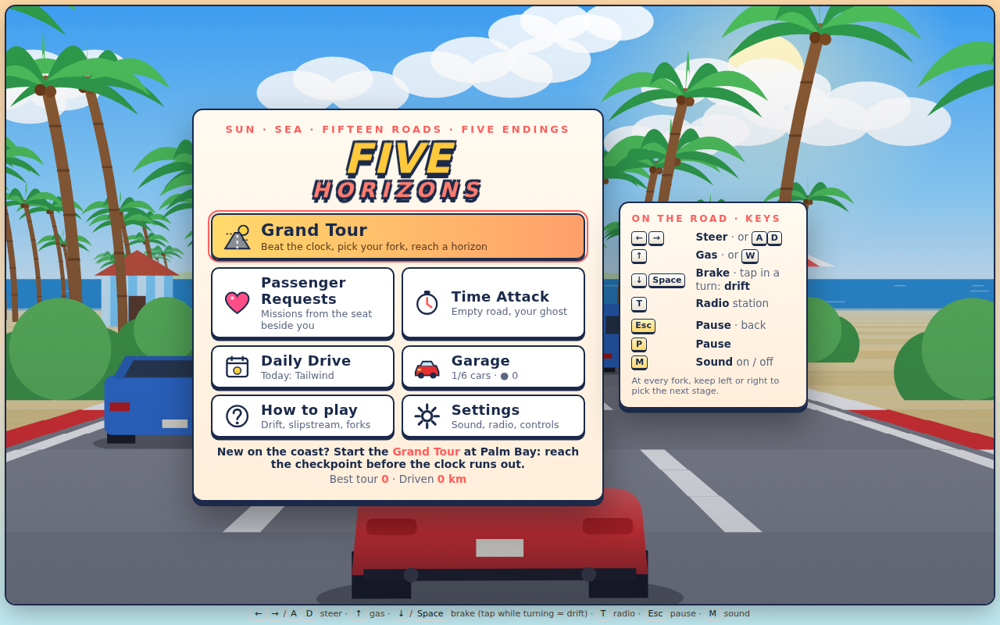
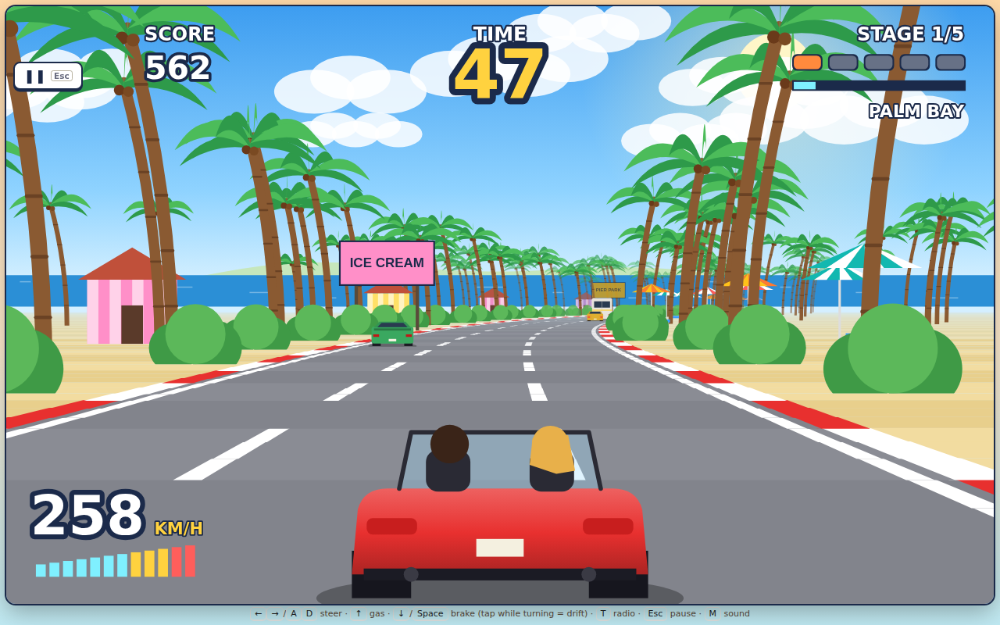

# Five Horizons

**Sunny coast racing against the clock: 15 stages, a fork after each, 5 endings, missions & 6 cars.**

<p align="center">
  
</p>

<p align="center">
  <a href="https://ai-llm-2030.github.io/TrueMarch_Games_Five_Horizons/"><b>▶ Play Five Horizons in your browser</b></a>
</p>

## Gameplay

<p align="center">
  
</p>

## Controls

| Keys | Action |
|---|---|
| ← → or A D | Steer |
| ↑ or W | Gas |
| ↓ or Space | Brake · tap while turning to drift |
| T | Radio station |
| Esc | Pause |
| M | Sound on / off |

## Run it yourself

No install, no build step, no server code, no network. The game runs entirely in your browser and keeps your progress in the browser's local storage.

```bash
git clone https://github.com/ai-llm-2030/TrueMarch_Games_Five_Horizons.git
cd TrueMarch_Games_Five_Horizons
python3 -m http.server 8000
# open http://localhost:8000
```

Opening `index.html` directly works too in most browsers; a local server is the most reliable way.

## What's inside

```
TrueMarch_Games_Five_Horizons/
├── index.html        the whole game: one file, plain JavaScript and <canvas>
├── lib/
│   ├── arcade.js     shared helpers: crisp canvas, frame loop, input, theme
│   └── arcade.css    shared look
├── assets/           the pictures in this README
├── LICENSE
└── README.md
```

Written from scratch in vanilla JavaScript: every sprite, background and sound is drawn or synthesised in code (Canvas 2D and the Web Audio API). No libraries, no frameworks, no third-party assets.

## About

**Five Horizons** is one of the 120+ games made by **[TrueMarch](https://truemarch.com)**. This repository is the standalone single-player edition of the game.

## License

© 2026 TrueMarch. All rights reserved. The source is published so you can read it, learn from it and play the game; see [LICENSE](LICENSE).
